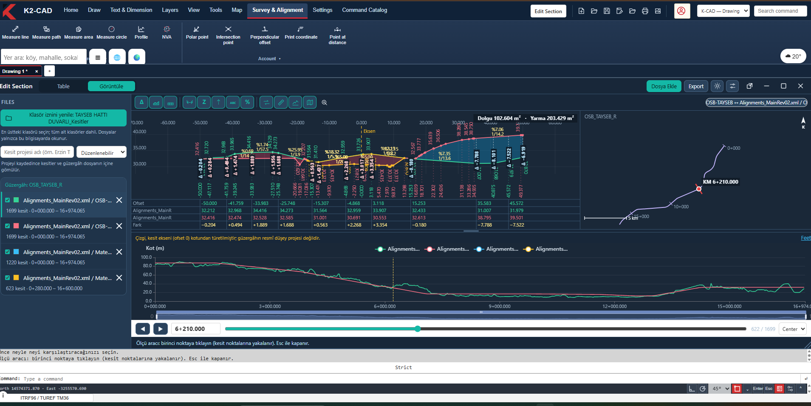
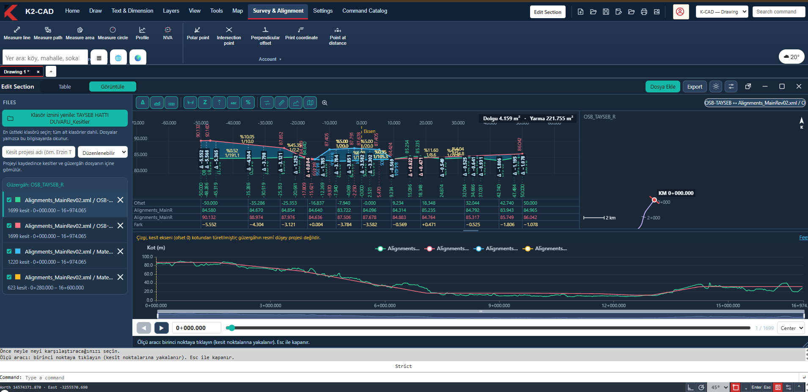
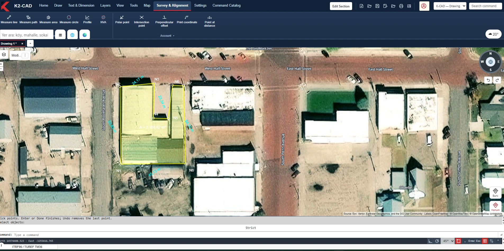
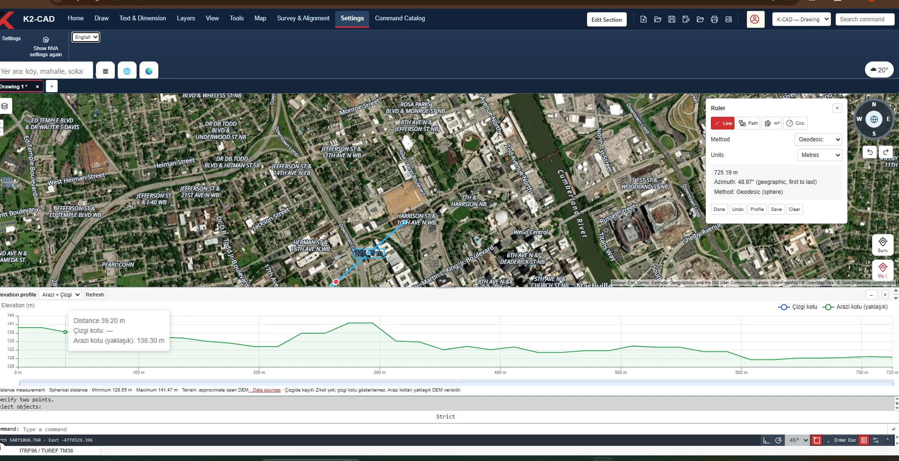
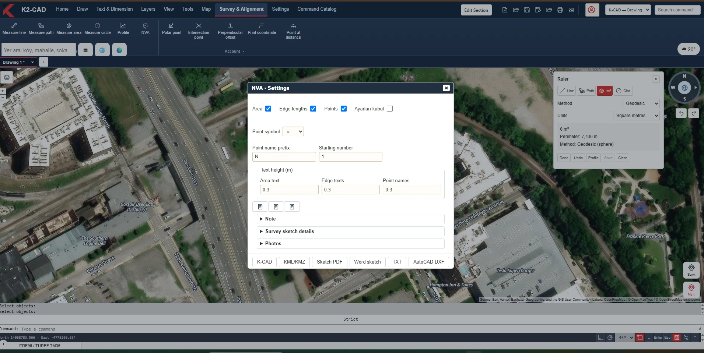

# K-CAD Pro

### Browser-based CAD + Map + Cross-section tool · Tarayıcıda çalışan CAD + Harita + Kesit programı

**🌐 Live demo / Canlı demo → [www.kariyerbelge.com/k3-cad/](https://www.kariyerbelge.com/k3-cad/)**

No download, no install, no sign-up. Open the link and start working.
İndirme yok, kurulum yok, üyelik yok. Linke tıklayın, hemen çalışmaya başlayın.

---

## ✨ Highlights / Öne çıkanlar

| | English | Türkçe |
|---|---|---|
| 📐 | Open and draw **DWG / DXF** with an AutoCAD-style ribbon | **DWG / DXF** açma ve çizim, AutoCAD tarzı menü |
| 🛰️ | Work on **satellite / hybrid / street maps** | **Uydu / hibrit / sokak haritası** üzerinde çalışma |
| 🛤️ | **Cross-sections & long profiles** from **LandXML** or **KSE** files | **LandXML** veya **KSE** dosyasından **enkesit ve boykesit** |
| ⚖️ | **Surface comparison:** cut/fill areas, slope ratios, elevation difference table | **Yüzey karşılaştırma:** dolgu/yarma alanı, şev eğimleri, kot farkı tablosu |
| 📏 | **Area survey (NVA):** corner points, edge lengths, area → PDF/Word sketch | **NVA:** köşe noktaları, kenar uzunlukları, alan → PDF/Word kroki |
| 📱 | Works on **desktop and mobile** (installable app) | **Bilgisayarda ve telefonda** çalışır (uygulama olarak kurulur) |

---

## 🖼️ Screenshots / Ekran görüntüleri

### Surface comparison · Yüzey karşılaştırma
Two surfaces on the same section: cut/fill areas, slopes (%, 1/n) and an elevation difference table. A chainage player walks through all sections.
Aynı kesitte iki yüzey: dolgu/yarma alanı, şev eğimleri (%, 1/n) ve kot farkı tablosu. Km oynatıcı ile tüm kesitler tek tek gezilir.

### Area survey (NVA) · Alan ölçümü (NVA)
Draw a parcel on the satellite map; corner names, edge lengths and the area are written automatically.
Uydu haritasında parseli çizin; köşe adları, kenar uzunlukları ve alan otomatik yazılır.

### Distance & terrain profile · Mesafe ve arazi profili
Geodesic distance, azimuth and an elevation profile along the line.
Jeodezik mesafe, açıklık açısı ve çizgi boyunca arazi kot profili.

### Exports · Çıktılar
One click to K-CAD, KML/KMZ, PDF sketch, Word sketch, TXT, AutoCAD DXF/DWG, Netcad NCN.
Tek tıkla K-CAD, KML/KMZ, PDF kroki, Word kroki, TXT, AutoCAD DXF/DWG, Netcad NCN.

---

## 🧰 All features / Tüm özellikler

**CAD**
- Line, polyline, arc, circle, rectangle, point, hatch · Çizgi, çoklu çizgi, yay, daire, dikdörtgen, nokta, tarama
- Move, copy, rotate, offset, trim, extend, mirror, scale, erase · Taşı, kopyala, döndür, ofset, buda, uzat, aynala, ölçekle, sil
- Layers, colors, linetypes, lineweights · Katmanlar, renk, çizgi tipi, çizgi kalınlığı
- Single/multi-line text, dimensions, leaders · Tek/çok satırlı yazı, ölçülendirme, oklu açıklama
- Command line and command catalog · Komut satırı ve komut kataloğu

**Map / Harita**
- Satellite, hybrid, street layers; place search · Uydu, hibrit, sokak katmanları; yer arama
- Coordinate systems incl. ITRF96 / TUREF TM zones · TUREF TM dahil koordinat sistemleri
- KML / KMZ import & export · KML / KMZ içe/dışa aktarma
- Measure line, path, area, circle; polar point, intersection, perpendicular offset · Çizgi, yol, alan, daire ölçümü; polar nokta, kesişim, dik ofset

**Alignment & sections / Güzergâh ve kesit**
- Alignments from LandXML / KTB · LandXML / KTB'den güzergâh
- Cross-sections from LandXML or KSE · LandXML veya KSE'den enkesit
- Multi-surface view, cut/fill areas, slope labels, difference table · Çok yüzeyli görünüm, dolgu/yarma, eğim etiketleri, fark tablosu
- Long profile with chainage slider · Km kaydırıcılı boykesit

**Output / Çıktı**
- PDF, Word, DXF, DWG, NCN, TXT, KMZ, K-CAD project file · PDF, Word, DXF, DWG, NCN, TXT, KMZ, K-CAD proje dosyası
- Optional Google Drive project storage · İsteğe bağlı Google Drive'a proje kaydı

---

## 💬 Feedback / Görüş ve öneri

Try the [live demo](https://www.kariyerbelge.com/k3-cad/) and share your feedback in [Issues](../../issues).
A single-user source code license is available — feel free to get in touch.

[Canlı demoyu](https://www.kariyerbelge.com/k3-cad/) deneyin, görüşlerinizi [Issues](../../issues) bölümüne yazın.
Tek kullanıcılık kaynak kod lisansı mevcuttur, iletişime geçebilirsiniz.

---

## About this repository / Bu depo hakkında

This is the showcase page of K-CAD Pro. It contains no source code.
Bu depo K-CAD Pro'nun tanıtım sayfasıdır; kaynak kod içermez.

Copyright (c) 2026 K-CAD. All screenshots and content are the property of the author.
